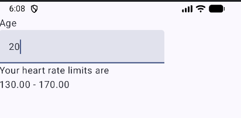

# Main code explanations
## 1. Variables

```kotlin
var age by remember { mutableStateOf("") }
```
**mutableStateOf("")**: Creates an observable state variable with an empty string as its initial value.

## 2.Data Conversion
```kotlin
val ageNumber = age.toIntOrNull() ?: 0
```

**toIntOrNull()**: Converts a string into an integer. Returns null if conversion fails.

?:: The Elvis operator. Provides a default value if the result is null.

0: The default value.

## 3.TextField
```kotlin
TextField(
    value = age,
    onValueChange = { age = it }
)
```
**TextField:** Creates an input field where the user can enter text.
**onValueChange:** Detects changes when the user types.

## 4.String Template

```kotlin
Text("${String.format("%.2f", lowerLimit)}")
```
**${}**: Inserts an expression into a string.

## 5.String resources
```kotlin
Text(stringResource(R.string.age))
```
The strings are stored in:**strings.xml**  

# Screenshot  



# Git workflow
Enable git under version control  
Create repository in Github(Also can Git → Create Git Repository )  
Git → Commit  
Add remote repository  
Git → Push
In Android Studio, Git → Update Project instead of using:git pull